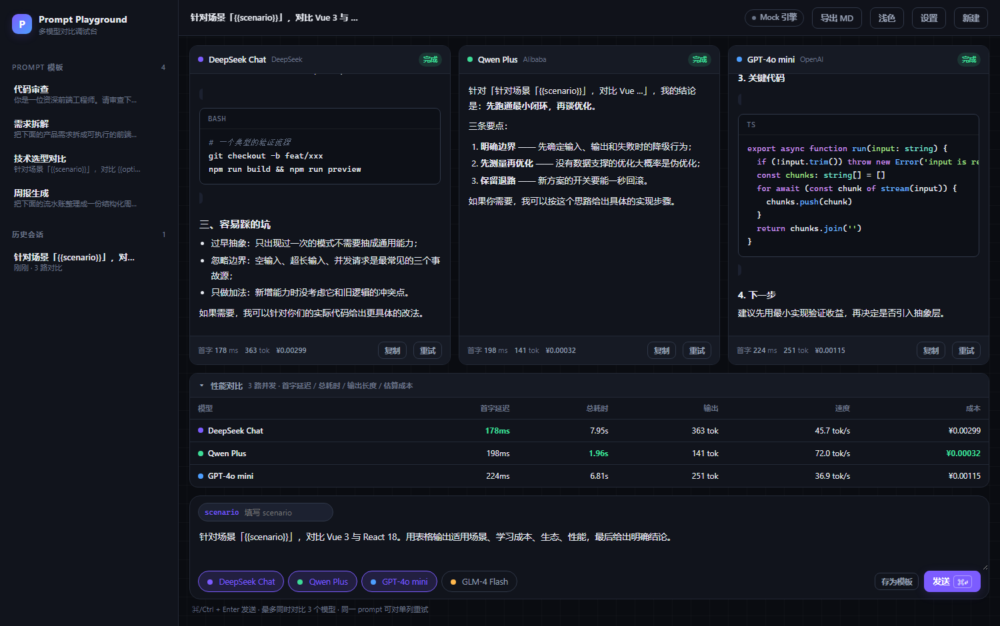
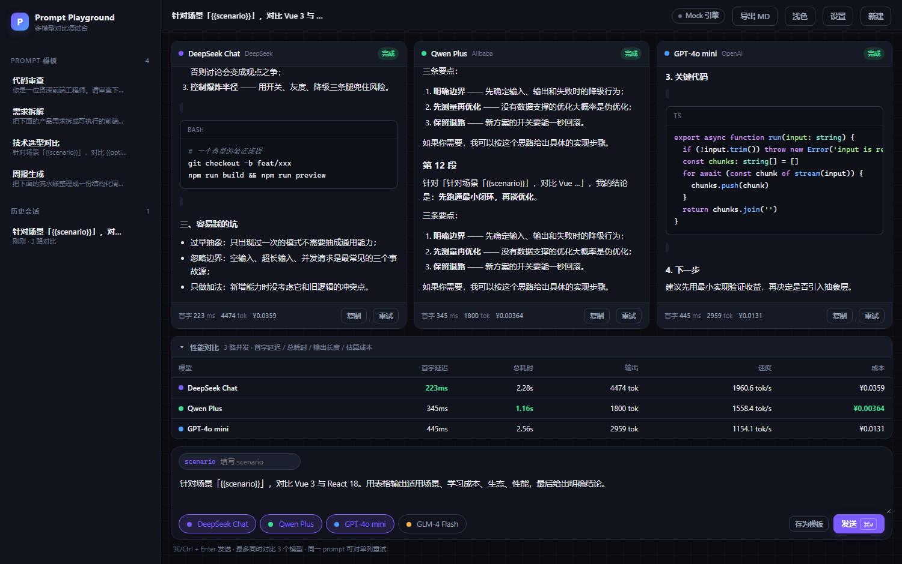

# Prompt Playground

> 同一个 prompt，并排看多个模型怎么答。实时对比输出质量、首字延迟与成本。

**[▶ 在线体验](https://prompt-playground.app.workbuddy.host/?sharecode=N5OFMQNTIY)** ·
**[三栏直接看效果](https://prompt-playground.app.workbuddy.host/?sharecode=N5OFMQNTIY&demo=1)** ——
不用 API Key，打开就是流式输出。

一个纯前端的多模型 Prompt 调试台：写一次 prompt 同时发给 1~3 个模型，逐字流式并排对比，
并把每次对比的首字延迟（TTFT）、总耗时、输出 token 与估算成本记录成表格。
内置 Prompt 模板库、`{{变量}}` 占位符、会话本地持久化，以及一个**不需要 API Key 的 Mock 引擎**——
任何人点开链接就能在 3 秒内看到完整的流式效果。

<!-- TODO: 换成 6~8 秒的 GIF 放这里：写 prompt → 三栏同时逐字输出 → 指标表出现差异 -->


## 快速开始

```bash
npm install
npm run dev        # http://localhost:5173
```

默认进入 Mock 模式，直接可用。想立刻看到对比效果，打开
`http://localhost:5173/?demo=1`（自动填入示例 prompt 并开跑）。

要连真实模型：右上角「设置」→ 关掉 Mock → 填接口地址与 API Key
（需兼容 OpenAI 的 `/chat/completions` 协议）。

```bash
npm run build      # 产物在 dist/，相对路径，可直接静态托管
npm run preview
```

## 部署

纯静态产物，`dist/` 直接丢到任意静态托管即可（Vercel / Netlify / Nginx / OSS）。
没有后端、没有环境变量、没有运行时依赖——这也是当初刻意只做纯前端的原因：
**任何一次部署都是一次 `vite build`，不存在"线上挂了因为是接口方的问题"**。

```bash
npm run build && npx serve dist   # 本地验证生产构建
```

线上版本：<https://prompt-playground.app.workbuddy.host/?sharecode=N5OFMQNTIY>

## 功能

- **多栏并发流式对比**：1~3 个模型共享同一个 prompt，同时拉流，互不阻塞
- **实时指标**：每栏底部实时显示首字延迟、输出 token、估算成本；底部表格横向对比并标出最优项
- **单列重试**：某一路失败或想再看看，只重跑这一列，其它列结果保留
- **Prompt 模板 + 变量**：`{{requirement}}` 这类占位符会渲染成输入框，改一次变量三栏同时生效
- **模板库 / 历史会话**：Dexie + IndexedDB 持久化，刷新不丢
- **中断 / 导出**：随时中断接收，一键导出 Markdown 对比报告
- **Mock 引擎**：模拟首字延迟与逐字输出，无 Key 可完整演示
- **明暗主题**：全部走 CSS 设计令牌，切换只改一层变量

## 技术要点

### 为什么用 SSE 而不是 WebSocket

模型推理是**单向**的流式输出，不需要双向通道。SSE 走普通 HTTP，能复用 keep-alive 与 HTTP/2 多路复用，
一条连接可以并发多条流；断线重连的语义也比 WebSocket 简单，不用自己维护心跳。代价是只能服务端→客户端，
但这件事上正好够用。

实现见 `src/lib/sse.ts`：手写 SSE 解析，处理了**跨 chunk 的多字节字符截断**（`TextDecoder` 需要
`{ stream: true }`）和**半帧 JSON**（JSON 还没收全时跳过，下一轮补齐）。

### 流式渲染为什么要做 100ms 批量提交

最直觉的写法是每收到一个 chunk 就 `setState`。但 markdown-it 是同步全量解析，
一段 3000 字的回答会产生几百次完整的「解析 → diff → 重排」，三路并发时主线程直接被打满，界面会明显掉帧。

`src/stores/playground.ts` 里对每一路流做了缓冲：chunk 先累加到 buffer，**每 100ms 才提交一次**到响应式状态。
渲染次数从「每 chunk 一次」降到「每 100ms 一次」，观感上仍然是逐字输出，但主线程占用下降一个数量级。

> 下一步可以做的：把 Markdown 解析放进 Web Worker，或者做增量渲染（只重解析最后一个未闭合的块）。

### 为什么用 IndexedDB 而不是 localStorage

- localStorage 只能存字符串，每次读写都要 JSON 序列化，且 1MB 上限很容易撞到
- localStorage 是同步 API，流式输出期间落盘会阻塞主线程
- IndexedDB 支持索引与游标，历史会话可以按时间倒序分页取

### 滚动锁定

流式输出时如果无脑 `scrollTop = scrollHeight`，用户往上翻历史会被强行拽回底部。
`src/composables/useAutoScroll.ts` 维护一个 `pinned` 状态：只有用户本来就在底部 48px 内才自动跟随，
一旦检测到上滑就解除跟随。

### 长文档：块级虚拟滚动

一份 12 段的长回答有 170+ 个 Markdown 块，全量渲染时每 100ms 一次的提交会让主线程持续重排。
做法（`src/lib/blocks.ts` + `src/composables/useVirtualList.ts`）：

- 按空行把文档切成「顶层块」，切分时跳过代码围栏，并把被空行拆散的列表 / 引用块合并回去
  （否则 `1. a\n\n2. b` 会渲染成两个都从 1 开始的列表）
- 块数超过 40 才启用虚拟滚动，小文档全量渲染 —— 短文档上虚拟化的测量开销大于收益
- 未测量的块用估算高度，前缀和 + 二分查找定位可视区间，上下各留 3 块 overscan

流式场景特有的三个坑，都在代码注释里标了：

1. **元素卸载时 `ResizeObserver` 会回调一次 0 高度**，直接把已测的真实值覆盖成 0，前缀和瞬间崩塌；
2. **`contentRect.height` 不含 padding**，而块间距是用 padding 撑的（margin 不计入元素高度，
   累加前缀和会一点点漂移）—— 所以测量统一走 `getBoundingClientRect()`；
3. **贴底时不能只依赖 scrollTop**：要滚到底就得先渲染末尾的块，渲染末尾的块又依赖「已经滚到底」，
   是个死循环。贴底时改成从「总高度 − 视口高度」反推可视区间。

另外，视口上方的块变高时会同步补偿 `scrollTop`，否则用户会看到正在读的内容被顶下去。

效果：170 块的文档，DOM 里只留 8~10 块；滚动过程中 `scrollHeight` 稳定在 9220px 不漂移。



用 CDP 做过真实交互验证（`npm run check:scroll`，需要先以 `--remote-debugging-port=9222` 启动浏览器）：

```
滚到底部时： {"blocks":23,"scrollTop":8925,"scrollHeight":9220}
滚到中段时： {"blocks":29,"scrollTop":4610,"scrollHeight":9220}
```

滚动前后渲染的块数都维持在 20 多，`scrollHeight` 不变 —— 说明视口外的块确实被摘掉、偏移量也没有累积漂移。

### 增量渲染

顺带解决了另一个问题：块切分之后，流式增长只会影响**最后一块**，
前面的块内容不变，`computed` 直接命中缓存，不会重新解析。
真正的解析量从「整篇 × 每秒 10 次」降到「最后一块 × 每秒 10 次」。

### 其他工程细节

- **AbortController 按列隔离**：每路流一个控制器，组件卸载 / 用户点中断时全部 abort，不会留下野流
- **markdown-it 关闭 `html: true`**：`v-html` 渲染前就已经过滤掉原生 HTML，不留注入面
- **highlight.js 按需注册语言**：只注册 8 种常用语言，避开完整版 1MB+ 的体积
- **Mock 失败自动回落**：真实接口报错时不影响演示

## 目录结构

```
src/
├── config/models.ts        模型清单（价格、速度、品牌色）
├── lib/
│   ├── sse.ts              SSE 流式请求 + 增量解析
│   ├── mock.ts             Mock 流引擎
│   ├── markdown.ts         markdown-it + 按需高亮
│   ├── blocks.ts           Markdown 顶层块切分
│   ├── metrics.ts          token 估算与成本计算
│   └── db.ts               Dexie schema + 种子模板
├── stores/
│   ├── playground.ts       并发流编排、100ms 批量提交、会话持久化
│   └── settings.ts         接口配置与主题
├── composables/
│   ├── useAutoScroll.ts    贴底跟随 + 用户上滑解除跟随
│   └── useVirtualList.ts   变高虚拟列表（二分查找 + 测高 + 偏移补偿）
└── components/
    ├── OutputColumn.vue    单栏：列头状态 / 滚动容器 / 指标脚注
    ├── MarkdownBlocks.vue  块级渲染 + 虚拟滚动接入
    └── ...                 侧边栏 / 指标表 / 输入区 / 设置
scripts/
└── check-virtual-scroll.mjs  CDP 真实滚动验证脚本
```

## 已知限制 / TODO

- [x] ~~长会话虚拟滚动~~ —— 块级虚拟列表已接入，见上文
- [x] ~~Markdown 增量渲染~~ —— 块切分后只重解析最后一块
- [ ] 把 Markdown 解析搬进 Web Worker：块切分已经把范围缩小到最后一块，但长代码块仍是同步解析
- [ ] 模板的版本历史与回滚
- [ ] 块切分的边界场景：松散列表、HTML 块、脚注仍需补用例
- [ ] 单元测试（SSE 解析器、块切分、token 估算都是纯函数，优先补这三个）
- [ ] 并发数超过 3 时的列宽自适应

## License

MIT
